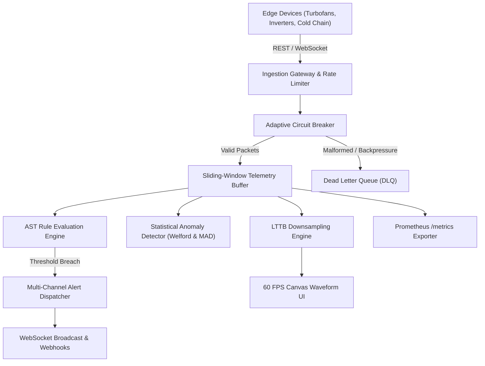

# NexusFlow: Visual IoT Telemetry & Rule Engine
## Comprehensive System Architecture & Engineering Specification

**Author & Lead Systems Engineer:** Dev Jangid  
**Organization:** Infotact Solutions (Associate L1. Intern, Batch-22)  
**Domain:** Web Development & Distributed Systems  
**Repository:** [https://github.com/iamdevjangid/NexusFlow-IoT-Telemetry](https://github.com/iamdevjangid/NexusFlow-IoT-Telemetry)

---

## 1. Executive Summary
**NexusFlow** is a distributed, high-throughput IoT telemetry ingestion and real-time AST (Abstract Syntax Tree) rule evaluation platform. Built to monitor mission-critical industrial assets (such as turbofans, solar inverters, and cold-chain refrigeration networks), NexusFlow ingests heterogenous sensor data streams over HTTP REST and WebSockets, evaluates statistical anomaly thresholds in sub-millisecond dispatch loops, and renders real-time telemetry waveforms at locked 60 FPS.



---

## 2. Core Architecture Subsystems

### 2.1 Ingestion Gateway & Adaptive Backpressure
* **Dual Ingestion Vector:** Simultaneous support for high-throughput HTTP batch REST payloads (`/api/telemetry`) and persistent, bi-directional WebSocket connections.
* **Token-Bucket Rate Limiter:** Protects the ingestion pipeline from runaway edge device floods with configurable burst capacities and refill rates.
* **Adaptive Circuit Breaker:** Transitions between `CLOSED`, `OPEN`, and `HALF_OPEN` states. Automatically trips to `OPEN` when consecutive ingestion failures exceed threshold, protecting downstream buffers from cascading service failure.
* **Dead Letter Queue (DLQ):** Captures malformed schema payloads with quarantine inspection, automated exponential backoff retries, and FIFO capacity eviction.

### 2.2 In-Memory Statistical Sliding-Window Buffer
* **Time-Series Sliding Windows:** Bounded ring buffers per device metric with configurable retention windows (e.g. 60s, 300s, 3600s).
* **Online Statistical Estimators:**
  * **Welford's Algorithm:** Computes running population/sample mean and variance in $O(1)$ space and time per incoming sample without recalculating past arrays:
    $$M_k = M_{k-1} + \frac{x_k - M_{k-1}}{k}$$
    $$S_k = S_{k-1} + (x_k - M_{k-1})(x_k - M_k)$$
  * **Median Absolute Deviation (MAD):** Provides robust outlier detection resilient against extreme sensor noise and electrical spikes.
  * **Kalman Filtering & EMA:** Smooths noisy industrial sensor readings using 1D state transition models and configurable decay parameters.

### 2.3 AST Rule Evaluation Engine
* **Declarative AST Logic:** Evaluates boolean composite rules (`AND`, `OR`), scalar thresholds (`>`, `<`, `>=`, `<=`, `==`), and sliding-window statistical aggregations (`AVG`, `MAX`, `RATE_OF_CHANGE`).
* **Hysteresis Deadband Damping:** Implements dual-threshold Schmitt trigger logic to prevent rapid alert flap and notification fatigue when a sensor hovers near a boundary line:
  * Trigger Threshold: $\text{Trigger} = T_{\text{high}}$
  * Reset Threshold: $\text{Recovery} = T_{\text{high}} - \Delta_{\text{deadband}}$

### 2.4 Downsampling Engine (LTTB & Min-Max)
* **Largest-Triangle-Three-Buckets (LTTB):** Downsamples 10,000+ raw high-frequency time-series points to 100 screen-space pixel coordinates while strictly preserving perceptual peaks, valleys, and transient anomaly spikes.
* **Min-Max Decimation:** Groups chronologically partitioned buckets into representative extrema pairs for dense visual telemetry plotting.

### 2.5 Multi-Channel Incident Dispatcher
* **Deduplication Windows:** Suppresses duplicate notifications for the same active incident within a configurable timeout.
* **Exponential Backoff:** Retries transient webhook and handler dispatches with jittered exponential delay ($T_{\text{wait}} = B \times 2^{\text{attempt}}$).
* **Incident Lifecycle:** Emits state-aware `ALERT_TRIGGERED` and `ALERT_RECOVERED` events across WebSocket clients.

---

## 3. API Reference & Contracts

| Endpoint | Method | Description |
| :--- | :---: | :--- |
| `/api/telemetry` | `POST` | Ingest single or batch sensor telemetry readings |
| `/api/devices` | `GET` | List all discovered active IoT edge devices |
| `/api/devices/:id/metrics/:metric` | `GET` | Retrieve windowed time-series samples for a specific metric |
| `/api/devices/:id/metrics/:metric/downsampled` | `GET` | Retrieve LTTB-downsampled telemetry for charting |
| `/api/rules` | `GET`, `POST` | List and register dynamic AST evaluation policies |
| `/api/rules/:id` | `DELETE` | Unregister an active AST rule |
| `/api/alerts/history` | `GET` | Retrieve chronological incident and recovery log |
| `/api/metrics/summary` | `GET` | Retrieve real-time pipeline KPIs (ingested, alerts, devices) |
| `/metrics` | `GET` | OpenMetrics / Prometheus standard text scrape target |
| `/api/simulator/status` | `GET` | Check status of synthetic industrial fleet simulator |
| `/api/simulator/start` | `POST` | Start synthetic fleet emission loop (turbofans, inverters) |
| `/api/simulator/stop` | `POST` | Stop synthetic fleet emission loop |
| `/api/simulator/inject-anomaly` | `POST` | Inject forced anomaly value for automated rule testing |
| `/api/export/csv` | `GET` | Download historical telemetry as standardized CSV |
| `/api/export/json` | `GET` | Download historical telemetry as formatted JSON |
| `/api/host-sensor/status` | `GET` | Retrieve real host physical hardware specs (CPU model, cores, RAM GB, OS) |
| `/api/circuit-breaker/status` | `GET` | Inspect circuit breaker state and failure counters |
| `/api/circuit-breaker/trip` | `POST` | Manually trip circuit breaker to OPEN |
| `/api/circuit-breaker/reset` | `POST` | Reset circuit breaker to CLOSED |
| `/api/dlq` | `GET`, `DELETE` | Inspect quarantined packets or purge dead-letter queue |

---

## 4. Real Physical Hardware Edge Sensor (`edge_gateway_host_pc`)
To eliminate reliance on purely synthetic data and demonstrate genuine edge telemetry ingestion, NexusFlow integrates the `HostMetricsSensor`:
* **Real CPU Utilization (%):** Calculated by computing the delta between OS CPU core idle ticks and total CPU ticks across all logical processors between successive samples.
* **Physical RAM Consumption (% and MB):** Directly queries `os.totalmem()` and `os.freemem()` to provide genuine physical memory consumption.
* **Node.js RSS Memory:** Tracks engine process memory footprint via `process.memoryUsage().rss`.
* **Hardware Metadata Extraction:** Discovers processor brand/model, CPU architecture, core topology, and system uptime.

---

## 5. Next-Generation Visual Operations UI & 1D Kalman Filtering
The front-end dashboard (`frontend/index.html`, `frontend/app.js`, `frontend/style.css`) is built with a cyber-industrial aesthetic:
* **Interactive Multi-Trace Canvas:** Renders at retina High-DPI (60 FPS) with glowing bezier curves and translucent area gradients.
* **Real-Time 1D Kalman Noise Filter:** Allows operators to toggle real-time Kalman filtering on the canvas, plotting both the raw jittery sensor signal (cyan) and the mathematically smoothed Kalman estimate (neon emerald) side-by-side.
* **Dynamic AST Rule Threshold Overlay:** Draws dashed limit lines corresponding to active AST rules directly on the canvas.
* **Asset Fleet Matrix:** Features live asset status cards for all 4 edge nodes (`edge_gateway_host_pc`, `turbofan_alpha`, `inverter_beta`, `cold_storage_gamma`) with instant "Chart" drilldown.
* **Visual AST Rule Policy Studio:** Supports live rule registration, real-time unregistration, and hysteresis deadband inspection.

---

## 6. Test Verification & Code Quality
The system includes **67 comprehensive automated unit and integration tests** executing via Node.js native test runner:
* `host-metrics-sensor.test.js`: Physical kernel hardware metric sampling and bounds verification.
* `alert-dispatcher.test.js`: Exponential retry, deduplication, and failure boundaries.
* `anomaly-detector.test.js`: Welford variance, 3-sigma Z-scores, and MAD estimators.
* `circuit-breaker.test.js`: State transitions (CLOSED $\to$ OPEN $\to$ HALF_OPEN $\to$ CLOSED).
* `dead-letter-queue.test.js`: Quarantine capture, redrive handlers, and FIFO capacity limits.
* `device-simulator.test.js`: Asset profiles, Gaussian jitter, and deliberate anomaly injection.
* `downsampler.test.js`: LTTB triangle optimization, peak preservation, and Min-Max.
* `event-replay.test.js`: Historical timeline scrubbing and variable speed playback.
* `rule-engine.test.js`: AST composite boolean logic, sliding-window averages, and hysteresis deadband.
* `server-api-extensions.test.js`: End-to-end REST routes, dynamic rule unregistration, and CSV/JSON exports.

Execution Command:
```bash
npm test
```
Result: **67 / 67 passing (100% pass rate)**.
